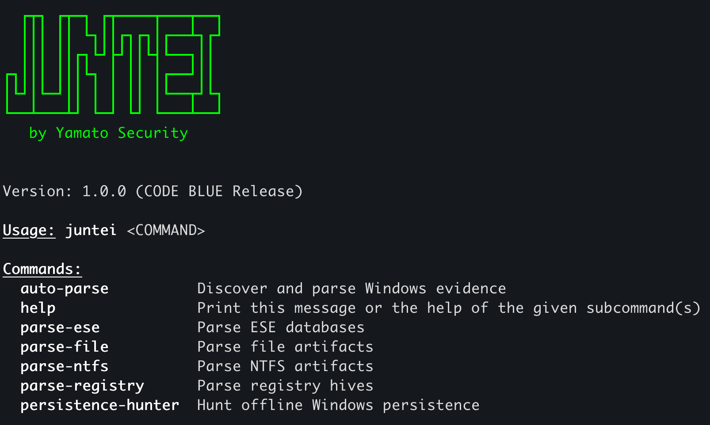
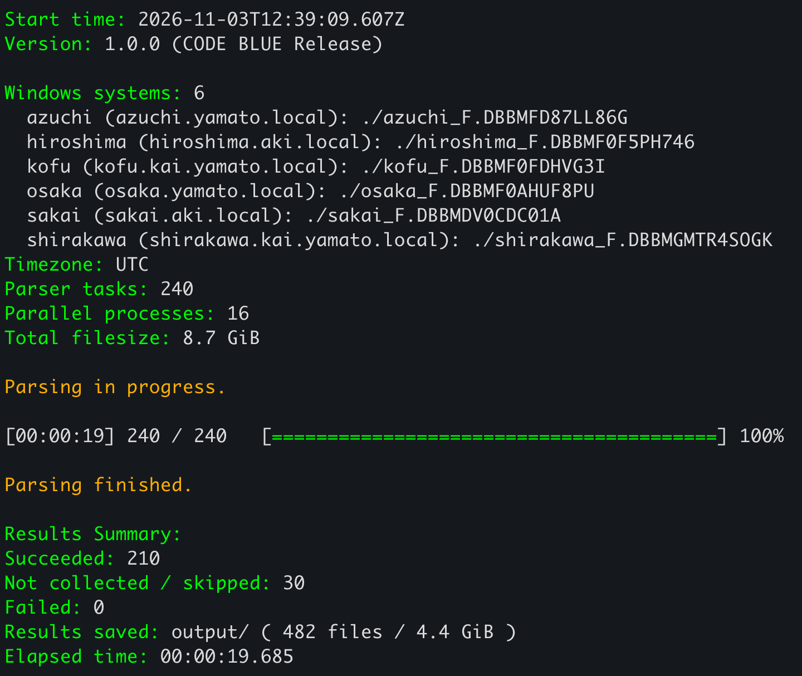
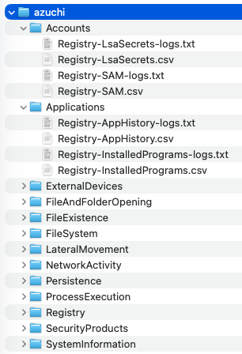

# 스크린샷 { #screenshots }

Juntei의 명령줄, 자동 분석, 그리고 체계적으로 정리된 조사 결과를 살펴보십시오.
스크린샷을 클릭하면 원래 크기로 볼 수 있습니다.

## 1. 시작 화면과 명령어 { #1-startup-and-commands }

<figure markdown>

<figcaption>Juntei의 시작 화면에는 자동 분석, 소스별 파서, 그리고 Persistence Hunter가 나열됩니다.</figcaption>

</figure>

## 2. 20초 이내에 완료되는 자동 분석 { #2-automatic-parsing-in-under-20-seconds }

**MacBook Pro M4**에서 아래와 같이 실행한 결과, **6개 시스템**에서 **수집한 8.7 GiB의 Windows 데이터**를
파싱하여 **20초 이내에 4.4 GiB의 출력**을 저장했습니다.
[auto-parse](commands/auto-parse.md) 명령은 16개의 병렬 프로세스를 사용하여 240개의 파서 작업을 실행했으며,
482개의 결과 파일을 생성했습니다. **210개 작업이 성공했고, 30개는 아티팩트가 수집되지 않아 건너뛰었으며,
실패는 0건**이었습니다.

<figure markdown>

<figcaption>자동 호스트 탐색, 병렬 파싱, 그리고 입력 크기, 출력 크기, 작업 결과 및 경과 시간을 보여 주는 완료 요약입니다.</figcaption>

</figure>

## 3. 조사하기 쉽게 정리된 결과 { #3-results-organized-for-investigation }

<figure markdown>

<figcaption>각 컴퓨터의 결과는 DFIR 범주별로 그룹화됩니다. 아티팩트 CSV와 이에 대응하는 <code>-logs.txt</code> 파일이 함께 보관되므로 레코드와 파싱 세부 정보를 모두 쉽게 찾을 수 있습니다.</figcaption>

</figure>
